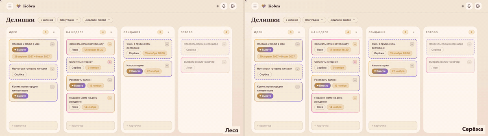
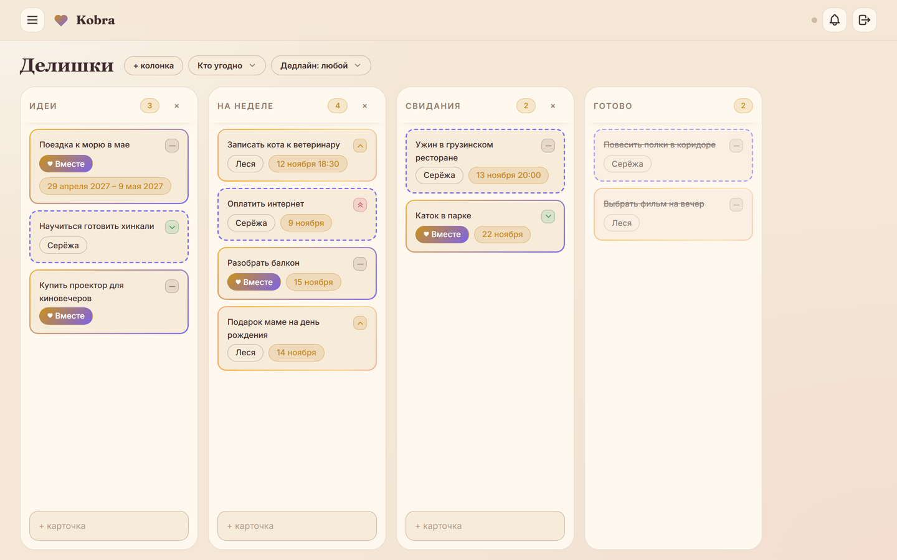
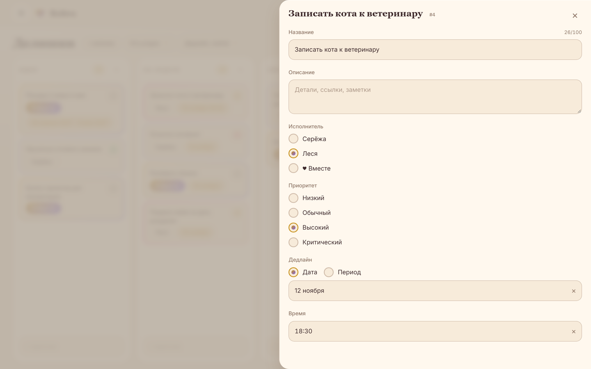
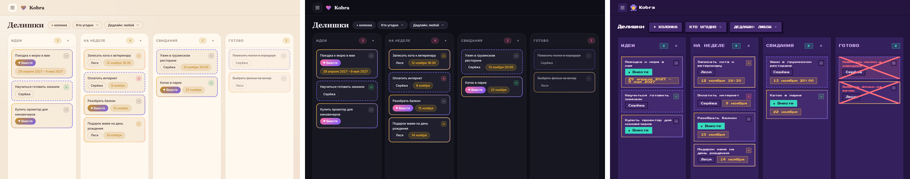
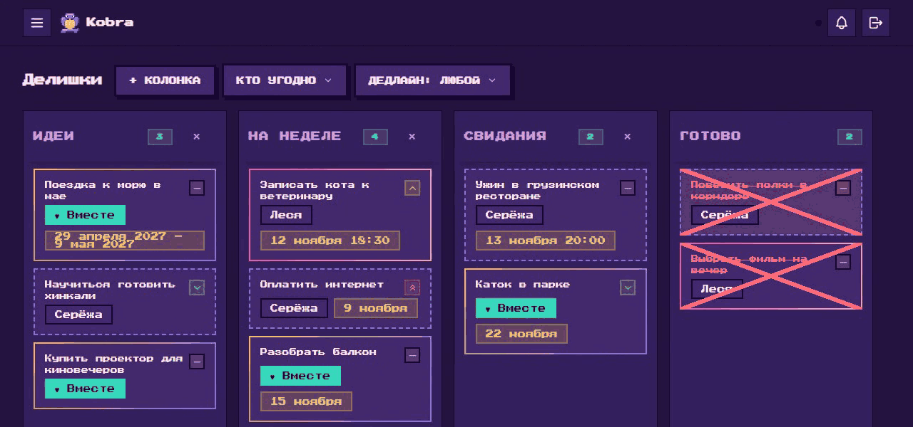

# Kobra

Трекер дел, который я сделал для нас с Лесей. Обычная канбан-доска, только на двоих: кто что делает, что горит, куда сходить на выходных. Всё, что один двигает, второй видит сразу, без перезагрузки.



*Слева Леся, справа Серёжа. Карточки переезжают у второго сами, зелёная точка сверху значит «второй сейчас тут».*

## Что умеет

- **Доска.** Колонки двигаются, карточки перетаскиваются. У задачи есть исполнитель (Леся, Серёжа или вместе), приоритет, дедлайн и время. Перетащил в «Готово», и задача закрыта: галочек нет.
- **Бэклог.** Сюда уходит всё, что сейчас не до того. Потом можно вернуть в любую колонку.
- **Фильтры** по исполнителю и дедлайну, включая «что уже просрочено».
- **Свой стиль карточек.** Каждый сам выбирает рамку для своих задач: цвет, градиент, пунктир, мерцание. По рамке сразу видно, чья задача.
- **Три темы:** светлая, тёмная и пиксельная. В пиксельной закрытая задача зачёркивается с тряской.
- **Ставится на телефон** как приложение (PWA).



| Карточка | На телефоне |
|---|---|
|  |  |



А в пиксельной теме закрытая задача перечёркивается крестом с тряской:



## Что внутри

Пара тут живёт как отдельный «арендатор», будто пользователей тысячи. Для двоих это перебор, но так было интереснее, и теперь можно не бояться, что что-то утечёт не туда.

- **Данные пары не смешиваются.** У всех таблиц пары есть `couple_id`, а глобальный скоуп подставляет его сам. Если контекст пары не задан, запрос не отдаёт всё подряд, а падает. Попытка переписать задачу в чужую пару тоже падает с отдельным исключением.
- **Реалтайм на Reverb.** На пару один presence-канал, по нему идут и изменения доски, и «кто в сети». Тест с двумя парами проверяет, что в чужой канал не пустит.
- **Контроллеры тонкие,** логика в сервисах. Наружу уходят только DTO (spatie/laravel-data), и из них же генерятся TS-типы для фронта.
- **Уведомления через outbox:** сначала запись в таблицу, потом джоба отправляет её на почту или в Telegram.
- **Закрытые задачи пишутся в журнал событий.** Из него уже считаются опыт и серия дней. На бэке это работает, интерфейса пока нет.
- **Фронт:** Vue 3, TypeScript, Pinia, Tailwind и своя дизайн-система с тремя темами.

## Что дальше

Вишлисты, где подарок можно тихо забронировать, календарь с нашими датами, напоминалки в Telegram и немного ИИ. Например, кидаешь «купить цветы к пятнице, срочно», и карточка заполняется сама. Список идей в [ROADMAP](.ai-factory/ROADMAP.md).

## Запуск

```bash
composer setup
```

```bash
php artisan db:seed --class=CoupleSeeder
```

```bash
npm run dev
```

```bash
php artisan reverb:start
```

Открывается на `http://cuploid.test/` (Herd). Пароль аккаунтов берётся из `COUPLE_SEED_PASSWORD`, а меняется командой `php artisan user:password <email>`.

Доки: [база](docs/DATABASE.md) · [реалтайм](docs/realtime.md) · [дизайн](docs/DESIGN-SYSTEM.md) · [компоненты](docs/ui-library.md)
