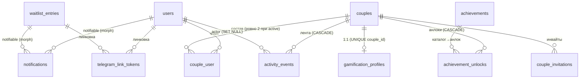

# Cuploid — Модель данных (ERD)

Источник правды по схеме БД. Стек: **PostgreSQL + Eloquent**. Архитектура: **пара = изолированный shard** (см. `.ai-factory/ARCHITECTURE.md`).

Статусы:
- **MIGRATE-NOW** — мигрируется на этапе 0 (фундамент + вайтлист).
- **DOCUMENT-ONLY** — задокументировано для совместимости FK, но НЕ мигрируется сейчас.

## Conventions

- Таблицы `snake_case` мн.ч.; столбцы `snake_case`; FK `<entity>_id`.
- **Все couple-owned таблицы** несут `couple_id BIGINT UNSIGNED NOT NULL`, FK → `couples.id` **ON DELETE CASCADE**, и используют trait `CoupleScoped` (global scope **fail-closed**).
- **Любая доменная мутация пары обязана писать `activity_events`** — это и аудит, и топливо геймификации (стрик/XP/ачивки выводятся из него).
- Nullable-unique на Postgres делаем **partial unique index** (`WHERE col IS NOT NULL`) — избегаем NULL-distinct ловушки.
- `couple_id` всегда в `$guarded` (никогда `$fillable`) — проставляется хуком из `CoupleContext`.
- Денормализация активности членства (`couple_user.is_active`) + partial unique — DB-инвариант «одна активная пара на юзера».
- Soft-delete только у `couples` (архив шарда); couple-owned дети НЕ soft-delete (заморозка через статус пары, уничтожение через FK cascade).

## Closed list — couple-owned таблицы (CI-гейт)

Эти таблицы scoped по `couple_id` и проверяются grep-гейтом (запрет `DB::table()` по ним, обязательный `couple_id`-предикат):

**Сейчас:** `gamification_profiles`, `activity_events`, `achievement_unlocks`, `boards`, `board_columns`, `cards`, `labels`, `card_label`.
**Будущие (DOCUMENT-ONLY):** `card_comments`, `wishlists`, `wishlist_items`, `item_reservations`, `couple_theme`, `couple_streak_days`, `hearts_transactions`, `couple_quests`.

> НЕ scoped (хотя связаны с парами): `couples` (это сам shard-root), `couple_user`, `couple_invitations` (membership / pre-active — доступ через lifecycle-сервисы, не tenant-запросами). `users`, `notifications`, `telegram_link_tokens`, `waitlist_entries` — cross/pre-shard.

## ERD (ядро, MIGRATE-NOW)

## MIGRATE-NOW таблицы

### users — НЕ scoped (cross-shard identity)
| Столбец | Тип | Заметки |
|---|---|---|
| id | bigint PK | |
| name | string nullable | |
| email | string UNIQUE nullable | nullable под tg-only позже |
| password | string nullable | passwordless-ready |
| email_verified_at | timestamp nullable | |
| avatar | string nullable | |
| timezone | string nullable | |
| locale | string nullable | default ru |
| telegram_id | bigint UNIQUE nullable | привязка Telegram |
| telegram_username | string nullable | |
| settings | json nullable | |
| timestamps, deleted_at (soft) | | |

Трейты: `HasApiTokens` (Sanctum), `Notifiable`. `couple_user.user_id` → CASCADE (удаление юзера чистит пивоты; уничтожение шарда — через `CoupleDeletionService`).

### couples — SHARD ROOT, НЕ scoped
| Столбец | Тип | Заметки |
|---|---|---|
| id | bigint PK | строка = сам shard |
| name | string nullable | имя пары |
| status | enum(pending,active,archived) | INDEX; tenant-резолв по `active` |
| created_by | bigint FK→users **SET NULL** | удаление юзера не блокит пару |
| settings | json nullable | тема/гамма (Customization), anniversary, timezone |
| cache_version | int unsigned default 0 | бамп при изменении членства (ротация кэшей/каналов) |
| archived_at | timestamp nullable | |
| timestamps, deleted_at (soft) | | dissolution = archive + soft delete |

Активация (`pending→active`) в транзакции эагерно создаёт `gamification_profiles`.

### couple_user — pivot, НЕ scoped
| Столбец | Тип | Заметки |
|---|---|---|
| id | bigint PK | |
| couple_id | FK→couples CASCADE | |
| user_id | FK→users CASCADE | |
| role | enum(owner,partner) | |
| is_active | bool default false | зеркалит couples.status при активации |
| joined_at | timestamp nullable | |
| timestamps | | |

Индексы: `UNIQUE(couple_id,user_id)`, `INDEX(user_id)`, **PARTIAL UNIQUE(user_id) WHERE is_active** (одна активная пара на юзера).

### couple_invitations — НЕ scoped (pre-active)
| Столбец | Тип | Заметки |
|---|---|---|
| id | bigint PK | |
| couple_id | FK→couples CASCADE | |
| inviter_id | FK→users | |
| invite_code | string UNIQUE | deep-link |
| email | string nullable | |
| status | enum(pending,accepted,expired) | |
| expires_at | timestamp | |
| accepted_by | bigint FK→users nullable SET NULL | |
| timestamps | | |

### gamification_profiles — couple-owned (CoupleScoped) ⚑
| Столбец | Тип | Заметки |
|---|---|---|
| id | bigint PK | |
| couple_id | FK→couples CASCADE **UNIQUE** | один профиль на shard |
| xp | bigint default 0 | общий (не per-user) |
| level | smallint default 1 | |
| hearts_balance | int default 0 | валюта (магазин — будущее) |
| current_streak | int default 0 | инвертированный (см. ниже) |
| longest_streak | int default 0 | сохраняется всегда |
| streak_last_qualified_on | date nullable | |
| last_processed_event_id | bigint nullable | exactly-once начисление XP |
| settings | json nullable | |
| timestamps | | |

**Стрик upside-only:** растёт, если активен ХОТЯ БЫ ОДИН партнёр в локальный день; «оба» = бонус; НИКОГДА не ломается из-за бездействия одного и не приписывается человеку.

### achievements — GLOBAL каталог, НЕ scoped
| Столбец | Тип | Заметки |
|---|---|---|
| id | bigint PK | |
| code | string UNIQUE | ключ |
| title, description, icon | string | |
| is_secret | bool default false | пасхалки |
| points | int default 0 | |
| criteria | json | условия анлока |
| sort_order | int default 0 | |
| timestamps | | |

Сидер: приватные/аддитивные ачивки (первая общая задача, стрик-вехи, первая годовщина [secret], 100 дней). **Без** Pioneer/Matchmaker/Cupid и ratio-ачивок.

### achievement_unlocks — couple-owned (CoupleScoped) ⚑
| Столбец | Тип | Заметки |
|---|---|---|
| id | bigint PK | |
| couple_id | FK→couples CASCADE | |
| achievement_id | FK→achievements CASCADE | |
| unlocked_by_user_id | bigint FK→users nullable SET NULL | warmth-атрибуция |
| unlocked_at | timestamp | |
| meta | json nullable | |
| timestamps | | |

`UNIQUE(couple_id, achievement_id)` (идемпотентно), `INDEX(couple_id)`.

### activity_events — couple-owned, append-only (CoupleScoped) ⚑
| Столбец | Тип | Заметки |
|---|---|---|
| id | bigint PK | |
| couple_id | FK→couples CASCADE **NOT NULL** | строго shard-local |
| actor_user_id | bigint FK→users nullable SET NULL | какой партнёр инициировал |
| type | string | event-key |
| payload | json nullable | |
| idempotency_key | string nullable | partial unique |
| occurred_at | timestamp | |
| timestamps | | |

Индексы: `INDEX(couple_id, occurred_at)`, `INDEX(couple_id, actor_user_id)`, **PARTIAL UNIQUE(couple_id, idempotency_key) WHERE idempotency_key IS NOT NULL**. Couple-less продюсера НЕТ.

### notifications — outbox, НЕ scoped, полиморфный
| Столбец | Тип | Заметки |
|---|---|---|
| id | bigint PK | |
| notifiable_type | string | morphMap: `user`→User, `waitlist`→WaitlistEntry |
| notifiable_id | bigint | |
| channel | enum(email,telegram,push) | |
| type | string | event-key |
| payload | json nullable | минимальный/несенситивный (текст рендерится при отправке) |
| status | enum(pending,sent,failed) | |
| scheduled_at | timestamp nullable | |
| sent_at | timestamp nullable | |
| attempts | int default 0 | |
| last_error | text nullable | |
| couple_id | bigint FK→couples nullable SET NULL | только для scoped admin-reads / purge |
| timestamps | | |

`INDEX(status, scheduled_at)`. Доставка роутится по `notifiable`, не по `couple_id`. Клиентское чтение — только по аутентифицированному notifiable.

### telegram_link_tokens — НЕ scoped (pre/cross-shard)
| Столбец | Тип | Заметки |
|---|---|---|
| id | bigint PK | |
| token | string UNIQUE | deep-link `?start=<token>` |
| user_id | bigint FK nullable | |
| waitlist_entry_id | bigint FK nullable | |
| telegram_id | bigint nullable | проставляется при линковке |
| status | enum(pending,linked,expired) | |
| expires_at | timestamp | |
| timestamps | | |

### waitlist_entries — НЕ scoped (pre-account)
| Столбец | Тип | Заметки |
|---|---|---|
| id | bigint PK | |
| email | string UNIQUE | |
| name | string nullable | |
| status | enum(pending,confirmed,invited) | |
| confirmation_token | string nullable | partial unique WHERE not null |
| confirmed_at | timestamp nullable | |
| telegram_id | bigint nullable | |
| utm_source/medium/campaign | string nullable | |
| locale | string nullable | |
| timestamps | | |

`INDEX(status, id)`. **БЕЗ** referral_code / referred_by / position. Порядок FIFO по created_at; позиция выводится на чтении (`COUNT confirmed WHERE id<=this.id`), не хранится. Конверсия в юзера — по email при регистрации (FK не держим).

> `personal_access_tokens` — создаётся Sanctum (`install:api`), не описываем.

## DOCUMENT-ONLY (будущие фичи — couple-scoped, не мигрируем сейчас)

### Kanban (✅ МИГРИРОВАНО, milestone Kanban)
- `boards`(couple_id, name, position), `board_columns`(couple_id, board_id, title, position), `cards`(couple_id, board_column_id, title, description, **assignee enum** him/her/together, due_at, done, completed_at, position), `labels`(couple_id, name, color), `card_label`(couple_id, card_id, label_id, unique). Все couple-scoped (CASCADE). `card_comments` — отложено. Real-time через Reverb `couple.{id}`.

### Wishlists (milestone Wishlists)
- `wishlists`(couple_id), `wishlist_items`(wishlist_id, title, url, price), `item_reservations`(item_id, reserved_by_user_id) — «скрытая бронь»: видна резервирующему, скрыта от партнёра.

### Customization Engine («цифровой ад»)
- `themes` (GLOBAL каталог), `couple_theme`(couple_id, theme_key, accent_key, custom_tokens json), `animation_presets`, `particle_presets`, `easter_eggs`. Выбор пары персистится shard-scoped; часть тем/гамм — за hearts.

### Gamification v2 (fast-follow, гейт по retention)
- `couple_streak_days`(couple_id, day, both_acted) — материализация стрика (бонус-флаг, не драйвер).
- `hearts_transactions`(couple_id, delta, reason, ...) — ledger валюты (баланс уже в gamification_profiles.hearts_balance).
- `quests` (каталог) + `couple_quests`(couple_id, quest_id, progress) — кооперативные, upside-only (истечение не показывать как провал).

### system_audit_log (если понадобится)
- Отдельная UNSCOPED таблица для couple-less/системного аудита — чтобы `activity_events` оставался строго shard-local NOT NULL.

## Жизненный цикл и удаление

- **Dissolution / выход** → `couples.status=archived` + `archived_at` + soft delete; гейм-стейт заморожен (retain). Бамп `cache_version`, инвалидация Reverb-nonce.
- **Re-pairing** → НОВАЯ строка `couples` (свежий shard), без переноса XP/стрика. Reconcile архива — только за grace-window флагом.
- **Account deletion** (right-to-be-forgotten) → `CoupleDeletionService` в транзакции: `couple->forceDelete()` (каскад по всем couple-owned детям) → удалить юзера → уведомить выжившего партнёра. По умолчанию grace-window + уведомление (Q3).
- **TTL-purge** архивных шардов — конфигурируемо (Q4).

## Порядок миграций (пиннированный)

`users` → `couples` → `couple_user` → `couple_invitations` → `achievements` → `activity_events` → `gamification_profiles` → `achievement_unlocks` → `notifications` → `telegram_link_tokens` → `waitlist_entries`.

CI: интроспекция `information_schema` — каждый `couple_id` FK обязан иметь `ON DELETE CASCADE`; проверка `migrate:fresh`.
